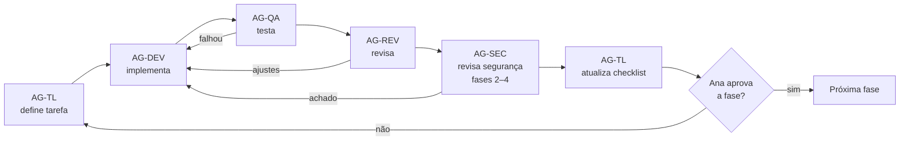
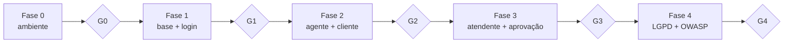

# RF01 — Plano de implementação

| Campo | Valor |
|---|---|
| Requisito | [RF01-chat-bancario-com-perfis.md](RF01-chat-bancario-com-perfis.md) |
| Design | [RF01-design.md](RF01-design.md) |
| Versão | 0.1 |
| Responsável (tech lead) | Ana |
| Forma de entrega | Direto na máquina local (`C:\Users\Teste\Desktop\finance-agent`), **sem commit** até a Ana pedir |

## 1. Como vamos trabalhar

- **Agentes de IA executam** o trabalho (código, testes, revisões) e **pessoas aprovam** cada etapa. Nenhuma fase começa sem a aprovação da fase anterior.
- São **4 fases incrementais**, precedidas de uma fase 0 de preparação. Ao final de cada fase o chat roda e os testes passam.
- O andamento fica registrado **neste arquivo**: o checklist da seção 5 e o registro de acompanhamento da seção 7.
- Segurança desde o início: os controles básicos (identidade na sessão, tools por perfil, autorização no código) entram já na fase 2. A fase 4 fecha o que falta de LGPD e OWASP e faz a validação final.

## 2. Papéis

### 2.1 Pessoas

| Papel | Quem | Responsabilidade |
|---|---|---|
| PO / Aprovadora | Ana | Aprova o resultado de cada fase (gate), decide os pontos em aberto e pede o commit. |
| Tech lead | Ana | Prioriza, aceita mudanças de escopo e valida o design. |

### 2.2 Agentes de IA

| Agente | Missão | Entradas | Saídas | Atua nas fases |
|---|---|---|---|---|
| **AG-TL — Orquestrador / Tech lead** | Quebra cada fase em tarefas, distribui para os outros agentes, atualiza o checklist e prepara o pacote de aprovação de cada gate | RF01, design, este plano | Checklist atualizado, resumo do gate, riscos | 0–4 |
| **AG-DEV — Desenvolvedor Python** | Implementa os módulos do design (seção 5 do design), seguindo o estilo do projeto | Tarefas do AG-TL, design | Código em `app/`, `requirements.txt`, `.env.example` | 0–4 |
| **AG-QA — Testes** | Escreve testes `pytest` a partir das regras (RN) e dos critérios de aceite (CA) e roda a suíte. Não chama a OpenAI | RF01 (RN/CA), código | `tests/`, relatório de testes, matriz CA → teste | 1–4 |
| **AG-SEC — Segurança, LGPD e OWASP** | Revisa o código contra a seção 8 (LGPD) e a seção 9 (ASI01–ASI10) do design. Roda `pip-audit` e o teste adversarial | Design, código | Relatório de segurança, achados com severidade | 2–4 |
| **AG-REV — Revisor de código** | Revisa cada fase: aderência ao design, legibilidade, tratamento de erros, nenhum segredo no código | Diff da fase | Lista de ajustes (bloqueante / sugestão) | 1–4 |
| **AG-DOC — Documentação** | Mantém `README.md`, `.env.example`, e o RF01/design quando algo mudar | Código, decisões | Docs atualizados | 0, 4 |

### 2.3 Fluxo de cada tarefa

### 2.4 Definição de pronto (vale para toda tarefa)

- Código segue o design (ou o design foi atualizado e aprovado).
- `.venv\Scripts\python -m pytest` passa, sem chamar a OpenAI.
- O AG-REV não deixou nenhum item bloqueante.
- O AG-SEC não deixou nenhum achado alto ou crítico (fases 2–4).
- O checklist foi atualizado.

## 3. Fases

### Fase 0 — Preparação do ambiente
**Objetivo:** projeto pronto para receber o código.

| ID | Tarefa | Agente | Entregável |
|---|---|---|---|
| F0.1 | Criar `.venv` (`py -m venv .venv`) e instalar dependências | AG-DEV | `.venv` funcionando |
| F0.2 | Fixar versões no `requirements.txt`: `strands-agents[openai]`, `python-dotenv`, `tzdata`, `pytest` | AG-DEV | `requirements.txt` |
| F0.3 | Incluir `dados/` no `.gitignore` | AG-DEV | `.gitignore` |
| F0.4 | Atualizar o `.env.example` com todos os parâmetros da seção 10 do design | AG-DOC | `.env.example` |
| F0.5 | Conferir se `.venv\Scripts\python -m pytest` roda os testes atuais | AG-QA | Saída do pytest |

**Gate G0 (Ana):** ambiente instalado e testes atuais passando.

### Fase 1 — Base, dados e login
**Objetivo:** login com usuário + PIN funcionando no terminal, com dados JSON fictícios.

| ID | Tarefa | Agente | Design | CA |
|---|---|---|---|---|
| F1.1 | `config.py`: ler P01–P08, retenção, `DADOS_DIR`, `FUSO`, `MAX_TOOLS_POR_MENSAGEM` | AG-DEV | §10 | — |
| F1.2 | `repositorio.py`: ler/gravar JSON com gravação atômica (`os.replace`) | AG-DEV | §4 | — |
| F1.3 | `auth.py`: PBKDF2 + salt, `autenticar`, bloqueio, recusa de login do aprovador | AG-DEV | §5.2 | CA01, CA02, CA19 |
| F1.4 | `sessao.py`: `SessaoUsuario` imutável com `session_id` uuid4 | AG-DEV | §5.1 | — |
| F1.5 | `auditoria.py`: gravar eventos no `auditoria.jsonl` | AG-DEV | §4 | — |
| F1.6 | `carga_inicial.py`: 2 clientes (um com histórico de saques, um sem), 1 atendente, 1 aprovador, dados fictícios | AG-DEV | §4 | — |
| F1.7 | `main.py`: tela de login com `getpass`, `sair` e `logout` (sem agente ainda) | AG-DEV | §5.9 | — |
| F1.8 | Testes de `repositorio`, `auth` e `config` | AG-QA | §11 | CA01, CA02, CA19 |
| F1.9 | Revisão da fase | AG-REV | — | — |

**Gate G1 (Ana):** consegue logar e deslogar, o bloqueio funciona, o aprovador não entra e os testes passam.

### Fase 2 — Agente e operações do cliente
**Objetivo:** o cliente conversa com o agente e consulta saldo/extrato, deposita e saca (saques **dentro** do padrão).

| ID | Tarefa | Agente | Design | CA |
|---|---|---|---|---|
| F2.1 | `permissoes.py`: matriz perfil × operação e `exigir()` | AG-DEV | §5.3 | CA04 |
| F2.2 | `operacoes.py`: saldo, extrato, depósito, saque (RN01, RN03, RN04) | AG-DEV | §5.4 | CA03, CA05 |
| F2.3 | `aprovacao.py`: interface `Terminal` com `confirmar()` (aqui só a confirmação sim/não) | AG-DEV | §5.5 | — |
| F2.4 | `tools.py`: fábrica `criar_tools(sessao, terminal)` com as tools do cliente (identidade guardada na closure) | AG-DEV | §5.6 | CA03, CA04 |
| F2.5 | `agente.py`: `OpenAIModel` (temperature 0), prompt com a data de hoje, tools do perfil, `FileSessionManager` em `dados/sessoes/` (sessão nova por login), `SlidingWindowConversationManager(20)` | AG-DEV | §5.7, §6 | — |
| F2.6 | `protecoes.py`: limite de tools por mensagem e auditoria das chamadas | AG-DEV | §5.8 | — |
| F2.7 | `main.py`: ligar o agente ao loop do chat e tratar erros da OpenAI | AG-DEV | §5.9 | — |
| F2.8 | Testes: operações, permissões, tools com `Terminal` falso, limite de tools | AG-QA | §11 | CA03–CA06 |
| F2.9 | Revisão de segurança: ASI02, ASI03 e ASI06 nesta fase | AG-SEC | §9 | — |
| F2.10 | Revisão da fase | AG-REV | — | — |
| F2.11 | Teste manual com a chave real: conversa completa do cliente | AG-QA + Ana | — | CA03–CA06 |

**Gate G2 (Ana):** a conversa como cliente funciona de ponta a ponta, o cliente não acessa outra conta e as sessões são gravadas em `dados/sessoes/`.

### Fase 3 — Atendente, estorno e aprovação
**Objetivo:** perfil atendente funcionando, com estorno e aprovação na mesma sessão para saque fora do padrão e estorno acima do limite.

| ID | Tarefa | Agente | Design | CA |
|---|---|---|---|---|
| F3.1 | `operacoes.py`: `motivo_aprovacao_saque` (P01, P02, P07, P08) e `motivo_aprovacao_estorno` (P03) | AG-DEV | §5.4 | CA06, CA07, CA14, CA18 |
| F3.2 | `operacoes.py`: `estornar` com motivo obrigatório (RN07) | AG-DEV | §5.4 | CA12, CA13 |
| F3.3 | `aprovacao.py`: `credenciais_aprovador()` com `getpass` + `auth.validar_aprovador` (solicitante ≠ aprovador) | AG-DEV | §5.5, §5.2 | CA08–CA10 |
| F3.4 | `tools.py`: tools do atendente (consultas de qualquer conta + `estornar`); `sacar` e `estornar` chamando o fluxo de aprovação | AG-DEV | §5.6, §7.2 | CA11, CA15 |
| F3.5 | Extrato e auditoria registrando quem aprovou | AG-DEV | §4 | CA08 |
| F3.6 | Testes de toda a regra de aprovação e da matriz do atendente | AG-QA | §11 | CA06–CA15, CA18 |
| F3.7 | Revisão de segurança: ASI03 (segregação) e ASI09 (confirmação feita pelo código) | AG-SEC | §9 | — |
| F3.8 | Revisão da fase | AG-REV | — | — |
| F3.9 | Teste manual com a chave real: saque com aprovação e estorno com aprovação | AG-QA + Ana | — | CA07–CA14 |

**Gate G3 (Ana):** os fluxos de aprovação aprovam e rejeitam corretamente, e o atendente não saca.

### Fase 4 — LGPD, OWASP e fechamento
**Objetivo:** dados pessoais protegidos, direitos do titular, retenção, validação de segurança final e documentação.

| ID | Tarefa | Agente | Design | CA |
|---|---|---|---|---|
| F4.1 | `lgpd.py`: `mascarar_cpf/email/telefone`, `mascarar_texto`, nome de terceiro abreviado | AG-DEV | §8.3 | CA17 |
| F4.2 | Aplicar o mascaramento na entrada do usuário, nos retornos das tools e na auditoria | AG-DEV | §8.3, §6 | CA17 |
| F4.3 | Comandos `meus dados` (sem passar pela IA) e `apagar meu histórico` (com confirmação, usando o índice de sessões) | AG-DEV | §8.4 | — |
| F4.4 | `aplicar_retencao()` ao iniciar: sessões com mais de 90 dias e auditoria com mais de 5 anos | AG-DEV | §8.5 | — |
| F4.5 | Aviso de transparência no login (dados processados pela OpenAI e retenção de 90 dias) | AG-DEV | §8.2, §8.6 | — |
| F4.6 | Testes de mascaramento, direitos do titular e retenção (com datas simuladas) | AG-QA | §11 | CA17 |
| F4.7 | Script adversarial com a chave real (prompt injection, pedido de outra conta, "sou o aprovador", tentativa de vazar CPF) | AG-SEC | §9 | CA16 |
| F4.8 | Checklist ASI01–ASI10 e checklist LGPD (seção 6 deste plano) + `pip-audit` | AG-SEC | §8, §9 | — |
| F4.9 | Matriz final CA01–CA19 → teste, todos cobertos | AG-QA | §11 | todos |
| F4.10 | Atualizar `README.md` (instalação no Windows, carga inicial, uso, perfis, testes) e o RF01/design se algo mudou | AG-DOC | — | — |
| F4.11 | Revisão final | AG-REV | — | — |

**Gate G4 (Ana):** todos os CAs têm teste e passam, não há achado alto ou crítico em aberto e a documentação está atualizada. Depois do G4, a Ana decide se pede o commit.

## 4. Dependências e ordem

Dentro de cada fase, AG-QA pode começar a escrever os testes a partir das RN/CA enquanto o AG-DEV implementa.

## 5. Checklist de acompanhamento

Status: `[ ]` pendente · `[~]` em andamento · `[x]` concluído · `[A]` aprovado pela Ana (só nos gates)

### Fase 0
- [x] F0.1 Criar `.venv` e instalar dependências — AG-DEV
- [x] F0.2 Fixar versões no `requirements.txt` — AG-DEV
- [x] F0.3 `dados/` no `.gitignore` — AG-DEV
- [x] F0.4 `.env.example` completo — AG-DOC
- [x] F0.5 Testes atuais rodando — AG-QA
- [A] **G0** Aprovação da Ana

### Fase 1
- [x] F1.1 `config.py` — AG-DEV
- [x] F1.2 `repositorio.py` — AG-DEV
- [x] F1.3 `auth.py` — AG-DEV
- [x] F1.4 `sessao.py` — AG-DEV
- [x] F1.5 `auditoria.py` — AG-DEV
- [x] F1.6 `carga_inicial.py` — AG-DEV
- [x] F1.7 Login no `main.py` — AG-DEV
- [x] F1.8 Testes da fase — AG-QA
- [x] F1.9 Revisão — AG-REV
- [A] **G1** Dispensado pela Ana ("pode seguir todas as fases sem perguntar")

### Fase 2
- [x] F2.1 `permissoes.py` — AG-DEV
- [x] F2.2 `operacoes.py` (cliente) — AG-DEV
- [x] F2.3 `aprovacao.py` (confirmação) — AG-DEV
- [x] F2.4 `tools.py` (cliente) — AG-DEV
- [x] F2.5 `agente.py` + sessão em arquivo — AG-DEV
- [x] F2.6 `protecoes.py` — AG-DEV
- [x] F2.7 Agente no `main.py` — AG-DEV
- [x] F2.8 Testes da fase — AG-QA
- [x] F2.9 Revisão de segurança — AG-SEC
- [x] F2.10 Revisão — AG-REV
- [ ] F2.11 Teste manual com a chave real — AG-QA + Ana (em andamento com a Ana)
- [A] **G2** Dispensado pela Ana; o teste manual F2.11 fica para o G4

### Fase 3
- [x] F3.1 Regras de aprovação — AG-DEV
- [x] F3.2 Estorno — AG-DEV
- [x] F3.3 Credenciais do aprovador — AG-DEV
- [x] F3.4 Tools do atendente + aprovação nas tools — AG-DEV
- [x] F3.5 Registro de quem aprovou — AG-DEV
- [x] F3.6 Testes da fase — AG-QA
- [x] F3.7 Revisão de segurança — AG-SEC
- [x] F3.8 Revisão — AG-REV
- [ ] F3.9 Teste manual com a chave real — AG-QA + Ana (em andamento com a Ana)
- [A] **G3** Dispensado pela Ana; o teste manual F3.9 fica para o G4

### Fase 4
- [x] F4.1 Funções de mascaramento — AG-DEV
- [x] F4.2 Mascaramento aplicado — AG-DEV
- [x] F4.3 `meus dados` e `apagar meu histórico` — AG-DEV
- [x] F4.4 Retenção — AG-DEV
- [x] F4.5 Aviso de transparência — AG-DEV
- [x] F4.6 Testes LGPD — AG-QA
- [x] F4.7 Teste adversarial — AG-SEC ([relatório](RF01-relatorio-seguranca.md): 1 achado alto e 1 médio em aberto)
- [x] F4.8 Checklists LGPD/OWASP + `pip-audit` — AG-SEC
- [x] F4.9 Matriz CA → teste — AG-QA (seção 5.1)
- [x] F4.10 Documentação — AG-DOC
- [x] F4.11 Revisão final — AG-REV
- [ ] **G4** Aprovação da Ana

### 5.1 Matriz CA → teste

| CA | Testes automatizados (`tests/`) |
|---|---|
| CA01 | `test_auth::test_ca01_login_ok` |
| CA02 | `test_auth::test_ca02_bloqueio_apos_tentativas` |
| CA03 | `test_tools::test_ca03_cliente_ve_o_proprio_saldo` |
| CA04 | `test_tools::test_ca04_cliente_pede_outra_conta` |
| CA05 | `test_operacoes::test_ca05_saldo_insuficiente`, `test_tools::test_ca05_saque_sem_saldo` |
| CA06 | `test_operacoes::test_ca06_saque_dentro_do_padrao`, `test_tools::test_ca06_saque_no_padrao_sem_aprovador` |
| CA07, CA08 | `test_operacoes::test_ca07_saque_fora_do_padrao`, `test_tools::test_ca07_ca08_saque_fora_do_padrao_aprovado` |
| CA09 | `test_tools::test_ca09_aprovacao_rejeitada` |
| CA10 | `test_auth::test_ca10_credenciais_sem_perfil_aprovador`, `test_tools::test_ca10_credenciais_de_cliente_ou_atendente` |
| CA11 | `test_tools::test_ca11_atendente_consulta_cliente` |
| CA12 | `test_tools::test_ca12_estorno_sem_motivo` |
| CA13 | `test_tools::test_ca13_estorno_com_motivo` |
| CA14 | `test_tools::test_ca14_estorno_acima_do_limite_pede_aprovador` |
| CA15 | `test_tools::test_ca15_atendente_nao_tem_tool_de_saque`, `test_operacoes::test_rn09_atendente_nao_saca_nem_deposita` |
| CA16 | `test_tools::test_ca16_tool_nao_aceita_aprovacao_por_parametro`, `test_agente::test_ca16_injecao_nao_libera_saque` (falta o teste com a chave real) |
| CA17 | `test_auth::test_ca17_pin_nao_vai_para_auditoria`, `test_tools::test_ca17_retorno_das_tools_sem_dados_pessoais`, `test_lgpd::*`, `test_agente::test_main_mascara_entrada_e_comandos` |
| CA18 | `test_operacoes::test_ca18_cliente_sem_historico`, `test_tools::test_ca18_cliente_sem_historico_pede_aprovador` |
| CA19 | `test_auth::test_ca19_aprovador_nao_abre_sessao` |

## 6. Checklists de segurança (usados pelo AG-SEC)

### 6.1 OWASP Top 10 para Aplicações Agênticas
- [ ] ASI01 Goal Hijack: ataques diretos e CA16 passam com a chave real; **ACH-01 (alto) em aberto**: injeção indireta pelo motivo do extrato
- [ ] ASI02 Tool Misuse: tools mínimas, limite de 5 tools por mensagem e uma tool por vez funcionam; **ACH-02 (médio) em aberto**: fracionamento de saque/estorno; ACH-03 (baixo): formatos de valor
- [x] ASI03 Identity & Privilege Abuse: identidade só pela closure; tools por perfil; aprovador via `getpass`; solicitante ≠ aprovador
- [x] ASI04 Supply Chain: versões fixadas; `pip-audit` sem vulnerabilidades conhecidas
- [x] ASI05 Code Execution: sem `eval`/`exec`/`subprocess` (conferido com busca no código)
- [x] ASI06 Memory Poisoning: sessão nova por login; saldo sempre vem da tool; sessões mascaradas
- [x] ASI07 Inter-Agent: não se aplica (agente único)
- [x] ASI08 Cascading Failures: erros tratados; gravação atômica
- [x] ASI09 Trust Exploitation: confirmação e aprovação feitas pelo código, com valores exatos
- [x] ASI10 Rogue Agents: toda chamada de tool auditada; `sair`/`logout` encerram na hora

### 6.2 LGPD
- [x] Dados de exemplo fictícios; `dados/` fora do git
- [x] CPF/e-mail/telefone mascarados nas respostas, no envio à OpenAI, nas sessões e na auditoria
- [x] PIN só como hash + salt; nunca em log
- [x] `meus dados` não passa pela OpenAI
- [x] `apagar meu histórico` apaga só as conversas e mantém movimentações e auditoria
- [x] Retenção de 90 dias (sessões) e 5 anos (auditoria) funcionando
- [x] Aviso de transparência no login

## 7. Registro de acompanhamento

O AG-TL acrescenta uma linha a cada evento relevante: início/fim de fase, gate, achado de segurança, mudança de escopo, decisão.

| Data | Fase | Evento | Decisão / próximo passo | Por |
|---|---|---|---|---|
| 07/11/2026 | — | Plano criado | Aguardando aprovação do plano para iniciar a Fase 0 | AG-TL |
| 07/11/2026 | 0 | Ana aprovou o plano e o início da Fase 0 | Iniciar Fase 0 | Ana |
| 07/11/2026 | 0 | Fase 0 concluída: `.venv` (Python 3.14.6), versões fixadas (`strands-agents[openai]==1.64.0`, `python-dotenv==1.2.4`, `tzdata==2026.6`, `pytest==9.2.0`, `pip-audit==2.10.1`), `dados/` no `.gitignore`, `.env.example` com P01–P08 e retenção. `pytest`: 4 passaram. `pip-audit`: nenhuma vulnerabilidade conhecida. Fuso `America/Sao_Paulo` ok no Windows. | Aguardando G0. Pendência: não existe `.env` (com a chave da OpenAI). Ele só é necessário a partir do teste manual F2.11 | AG-TL |
| 07/11/2026 | 0–4 | Ana aprovou o G0 e pediu para seguir todas as fases sem perguntar | G1–G3 dispensados; testes manuais com a chave ficam para o G4 | Ana |
| 07/11/2026 | 1–4 | Fases 1 a 4 implementadas: 15 módulos em `app/` (inclui `servicos.py`, que não estava no design) e 93 testes passando sem chamar a OpenAI, com modelo simulado para o agente completo. `pip-audit` sem vulnerabilidades conhecidas. Base fictícia criada com `carga_inicial --demo`. Design e RF01 ajustados: CA04 nega e audita quando o cliente informa outra conta; uma tool por vez (`SequentialToolExecutor`); retorno das tools usa `resultado` | Ana fazendo o teste manual com a chave real (F2.11, F3.9, F4.7) e depois o G4 | AG-TL |
| 07/11/2026 | 4 | Teste adversarial OWASP com a chave real (`seguranca/teste_adversarial.py`, 23 cenários × 3 rodadas + 8 verificações de código): 27 passaram, 4 falharam. Achados: ACH-01 alto (injeção indireta), ACH-02 médio (fracionamento), ACH-03/04/05 baixos. Ver [relatório](RF01-relatorio-seguranca.md) | G4 bloqueado até corrigir ACH-01 e ACH-02 e reexecutar o script | AG-SEC |

## 8. Riscos

| Risco | Impacto | Mitigação |
|---|---|---|
| Mudanças de API do Strands (ex.: `current_time` foi removida do strands-agents-tools 0.9.0) | Código quebra ao atualizar | Versões fixadas; AG-REV confere o changelog antes de atualizar |
| Custo e instabilidade da API da OpenAI | Testes manuais mais caros/lentos | Testes automatizados sem API; teste com a chave real só nos gates |
| Modelo ignora instruções (prompt injection) | Operação indevida | Autorização no código (design D8); teste adversarial |
| Vazamento de dado pessoal em sessão/log | Não conformidade LGPD | Mascaramento na entrada e nas tools; checklist 6.2 |
| `python` não está no PATH do Windows | Comandos falham | Usar `py` e `.venv\Scripts\python` |
| Movimentação e saldo ficam em dois arquivos JSON gravados em sequência | Se o programa cair entre as duas gravações, o saldo pode ficar diferente do último `saldo_apos` | Cada arquivo é gravado de forma atômica; aceito nesta versão local (PA-D1) |

## 9. Pontos em aberto herdados

Ainda precisam de decisão, mas não bloqueiam o início:
- RF01: PA02–PA06.
- Design: PA-D1–PA-D3.

O AG-TL deve levar essas decisões à Ana até o gate da fase em que cada uma for necessária.
